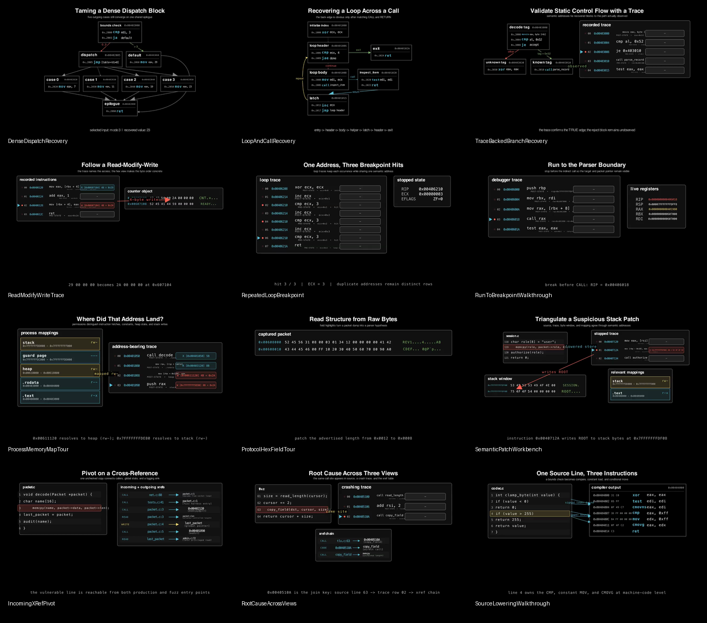
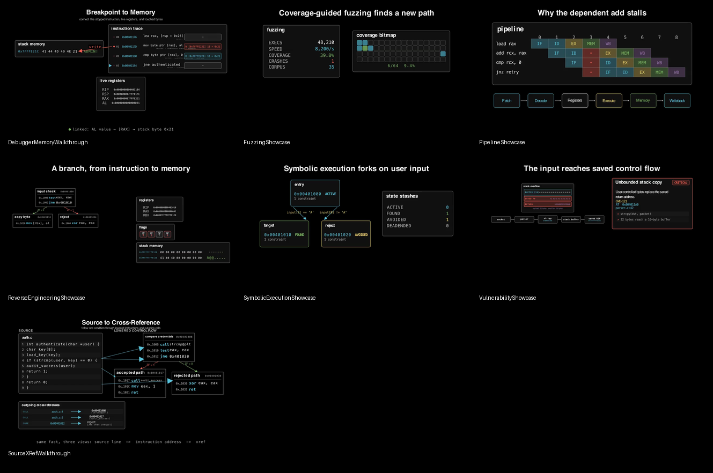
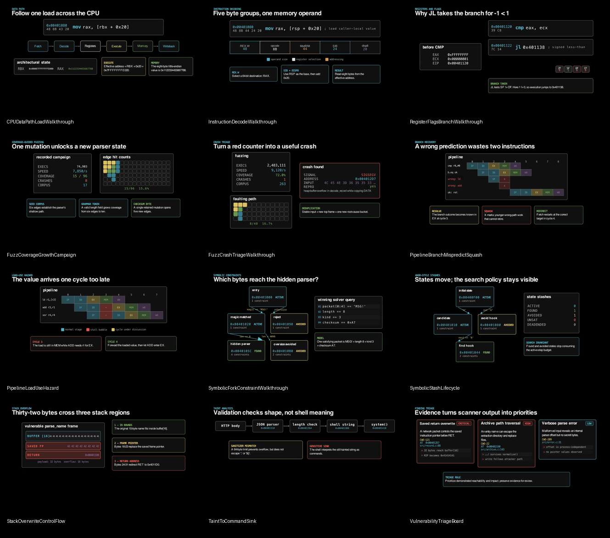
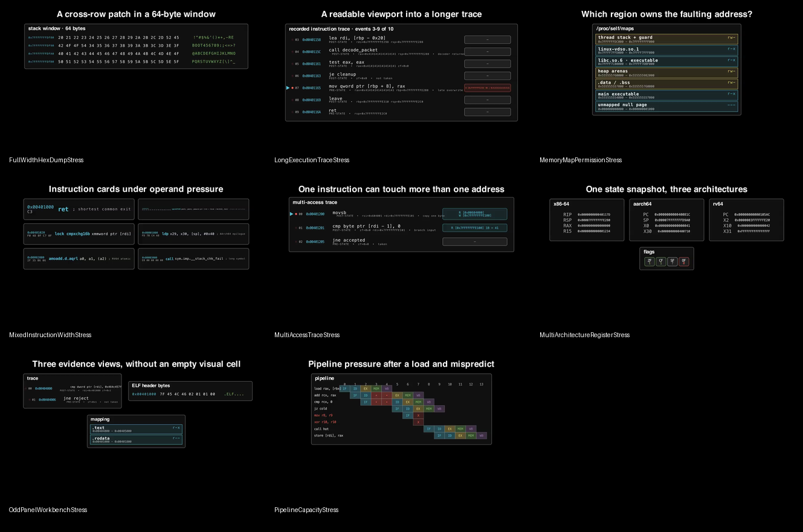

# Visual QA record

This page records the release-candidate visual audit for Manim Rev 0.1.0 after
the flat, Manim-aligned visual redesign. It is evidence for the bundled
examples, not a promise that arbitrary user data will fit without
scene-specific composition.

## Result

| Item | Result |
| --- | --- |
| Audit date | 2026-08-09 |
| Manim | Community Edition 0.20.1, Cairo renderer |
| Render profile | 854×480, 15 fps (`-ql`) |
| Corpus | 39 of 39 scenes rendered |
| Sampled frames | 117: early, middle, and final for every scene |
| Automated review prompts | 0 |
| Human review | No unresolved content, clipping, contrast, density, routing, or continuity findings |

The human pass checked that every scene's visible evidence supports its class
docstring, that technical labels remain readable at the QA resolution, that
important objects stay within the frame, and that animation endpoints do not
leave accidental or contradictory states.

## Reproduce the audit

Run these commands from the repository root:

```bash
uv sync --extra dev
uv run python scripts/render_examples.py --jobs 3 --timeout 240
uv run python scripts/qa_examples.py
```

The renderer writes `build/qa/render-report.json`. The QA pass writes
`build/qa/qa-report.json`, extracts three frames per scene, and creates final
and timeline contact sheets under `build/qa/contact-sheets/`. Build artifacts
are intentionally ignored; the reviewed sheets below are retained with the
documentation.

Heuristics flag likely blank frames, tight margins, edge clipping, low
contrast, and excessive visual density. A clean heuristic result never replaces
human inspection, so both checks are required for this record.

## Reviewed galleries

### Analysis and debugging — 12 scenes



[Open the analysis early/middle/final sheet](assets/visual-qa/analysis-timeline.png).

### Integrated core showcases — 7 scenes



[Open the core early/middle/final sheet](assets/visual-qa/core-timeline.png).

### CPU and security — 12 scenes



[Open the security early/middle/final sheet](assets/visual-qa/security-timeline.png).

### Component limits — 8 scenes



[Open the stress early/middle/final sheet](assets/visual-qa/stress-timeline.png).

## Changes driven by the audit

The render-and-review loop produced concrete design and example corrections:

- basic blocks now use a fitted label/address header, shared instruction
  columns, one divider, neutral outlines, and no alternating row cards;
- CFG layers use the longest forward path after excluding loop and detected
  back edges, keeping dense merge blocks below all of their predecessors;
- distributed block ports separate fan-out and fan-in arrows, while long and
  back edges use outside lanes with backed, direction-aware labels;
- traversal and semantic focus use passing outlines instead of recoloring an
  opaque block and making its instructions unreadable;
- the loop, dense-dispatch, trace-backed, and integrated CFG examples were
  recomposed and rechecked at 854×480;
- the package themes, panel titles, retained contact sheets, demo videos, and
  GitHub Pages design now use flat black/white/gray structure with Manim's
  familiar blue, green, yellow, and red accents rather than terminal chrome;
- branch-misprediction timelines stop squashed instructions at the actual
  flush cycle instead of showing impossible future stages;
- trace views support readable windows, duplicate instruction addresses,
  explicit pre/post snapshots, and multiple memory accesses per instruction;
- vulnerability examples identify the correct saved return-address bytes;
- cards reserve room for badges, taint arrows have deliberate routes, compact
  memory maps adapt to their row count, and odd workbench layouts center their
  trailing pane; and
- manual CFG positions and semantic links give talk authors escape hatches for
  unusually dense evidence.

For the scene inventory and individual render commands, see the
[example catalog](examples.md).
